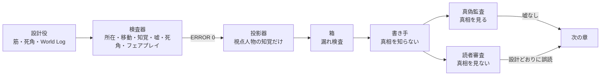

## はじめに

このシリーズでは、AIに小説を書かせる「制作スタジオ」を作ってきました。

- [1本目](https://zenn.dev/infra_ojisan/articles/ai-novel-studio-metaharness)：スタジオの組み方
- [2本目](https://zenn.dev/infra_ojisan/articles/ai-novel-studio-part2)：書き手のモデルの選び方と、文章の余白
- [3本目](https://zenn.dev/infra_ojisan/articles/ai-novel-studio-part3)：シリーズものを伏線の負債として管理する
- [4本目](https://zenn.dev/infra_ojisan/articles/ai-novel-studio-part4)：書いた小説を公開するまでのエンジニアリング
- [5本目](https://zenn.dev/infra_ojisan/articles/ai-novel-studio-part5)：AIエージェントのチームに書かせたら人狼ゲームになった話
- [6本目](https://zenn.dev/infra_ojisan/articles/ai-novel-studio-part6)：道具を v1.0 にして公開した

ずっとうまくいっていないことが一つあります。**ミステリ**です。

[企画書コンペ](https://zenn.dev/infra_ojisan/articles/ai-novel-proposal-compe)では、ミステリを頼むと全員が「語り手が犯人」を出してきました。自分で真相台帳と二重読み表と公正判定まで用意した作品（グラウヴァル第一作の原型）でも、仕上がりは「よくできた説明文」に寄っていきました。

今回は、その原因を分解して、**書き手に真相を渡さない**作り方を設計し、最小の実験（PoC）を組んだ話です。どちらかというと自分の理解のためのまとめです。

小説家になりたいわけでも憧れがあるわけでもなく、ただあまり「エンジニアリング」されてない分野でありながら「エンジニアリング」的アプローチで答えに到達できそうだからやっています。

## 先に結論

- AIのミステリが成立しにくいのは、**書き手が真相を知っているから**です。知っていることは、親切に埋めてしまいます。
- だから、トリックを書き手の意図で作らず、**入力の欠落で作ります**。真相を構造化した台帳（World Log）にし、そこから**視点人物が知覚できたことだけ**を投影して書き手に渡します。視点人物が取り違えていれば、書き手も取り違えたまま「正しく」書きます。
- 審査は二つに分け、**合格の向きを反転**させます。真相を見る監査は「嘘は不可、錯誤は可」。真相を見ない読者役は「設計どおりに誤読したら合格、早すぎる看破は不合格」。
- グラウヴァルの世界で、日常の謎の小品（3章・約1万字）の真相台帳・検査器・投影器を作りました。検査器は、**私（Claude）が書いた真相の時刻表から26件の誤りを拾いました**。
- この作り方はミステリに限りません。どんでん返しも伏線回収も「読者の見立ての推移」として**計算できる**ようになります。いまの連載は「書いたものから辻褄を合わせて深掘りする」アジャイル的な書き方ですが、**最終形を先に決めて一気に作るウォーターフォール的な書き方**もできるようになります。謎解きがある話は、後者のほうが収まりがよいはずです。
- まだ本物の書き手では一章も書かせていません。設計と道具の段階です。

## 1. なぜAIのミステリは収束するのか

ミステリは、5W1H（誰が・いつ・どこで・何を・なぜ・どうやって）の一部を読者から隠し、ときに**別のものに見せる**ことで成立します。ところが生成AIに BRIEF と CANON から書かせると、次の三つが同時に起きます。

| 原因 | 何が起きるか |
|---|---|
| 書き手が全知 | CANON に真相台帳が入っている。LLM は知っていることを「親切に」埋める。伏線を立たせ、5W1H を揃え、因果を通す。「知っているが書かない」を指示で守らせるのは、LLM がいちばん苦手なこと |
| 審査が「明瞭さ」を見る | 錯誤を起こす文は、ふつうの審査では欠陥として落ちる。ミステリでは評価関数の向きが逆でなければいけない |
| CANON が自然言語 | 要素をマスクしても、モデルが推論で補う。驚くほど収束した内容になる |

第一作の原型では、BRIEF に「地の文は嘘をつかない。誤導は省略・曖昧な言い方・並べる順番・呼び方でだけ行う」と書きました。正しい規則です。ただ、それを守る責任を**真相を知っている書き手**に負わせていました。ここが根っこでした。

## 2. 考え方：トリックは「入力の欠落」で作る

### 2-1. 三つの死角

読者を誤らせる場所は、三つの軸に分けられます（プロデューサー案）。

| 死角 | 誰も観測できないもの | 主観で錯誤しやすいもの | 隠れる 5W1H |
|---|---|---|---|
| 認識 | そこにいても認識できないもの | 人によって認識が異なるもの（同一人物に見える、別人に見える） | Who・What |
| 時間 | 誰も観測できない時間 | 叙述で語ると経過を取り違えやすい場面（鐘の数え違い、眠り、圧縮） | When |
| 場所 | 誰も観測できない場所 | 叙述で語ると場所の変化を取り違えやすい場面（似た部屋、同じ名の場所） | Where |
| 組み合わせ | | | How（トリック本体） |

ここで Why（ホワイダニット）を主役から外します。動機は心理の解釈なので、知覚の設計では作れません。真相側には持たせておき、解決章で軽く明かすだけにします。そのぶん、**ハウダニットとフーダニットは計算で作れる**ようになります。

### 2-2. 投影：書き手は視点人物と同じだけしか知らない

この考え方の芯は一つです。

> 真相を台帳にして、視点人物が知覚したことだけを書き手に渡す。

書き手は真相を知らないので、補いようがありません。視点人物が別人を同一人物だと思っていれば、書き手のパケットにもそう書いてあります。書き手は、自分の知っている範囲で「正しく」書くだけで、読者を誤らせる文になります。**「地の文は嘘をつかない」が、書き手の努力ではなく入力の作りで守られる**のがポイントです。



### 2-3. 審査の向きを反転させる

| 審査 | 見るもの | 合格 | 不合格 |
|---|---|---|---|
| 真偽監査 | 真相台帳と本文 | 地の文が事実に反しない。思い込みは「〜だろう」の形でだけ書かれている | 地の文が取り違えた名で断定する。嘘をつけない者が偽りを言う |
| 読者審査 | 本文だけ | 章末で、**設計した誤った見立て**を持つ | 早すぎる看破（第1章で真相を確信される） |

読者審査は、これまで完成後に一度だけ回していた公正判定を、**章ごとのループの中**に入れたものです。

## 3. 実装：真相台帳・検査器・投影器

実験は `novel-tools/Series_Grauwall/experiments/mx01/` に置きました。Python の標準ライブラリと PyYAML だけで動きます。

```
mx01/
├── truth/WORLD.yaml        真相台帳（作者のみ）
├── tools/mx.py             検査・図・投影・漏れ検査・箱づくり
├── out/author/             検査報告・タイムライン図・読者審査の合格条件（作者のみ）
├── out/packets/            章ごとの書き手パケット
├── prompts/                書き手・真偽監査の依頼文
└── dist/                   書き手と読者役に渡す箱（ここだけを渡す）
```

### 3-1. 真相台帳のデータモデル

台帳は六つの部品でできています。

**場所**：建物の中かどうか（この世界では、組合の建物の中でだけ「嘘をつけない誓約」が効く）、道のり（分）、どこから何が見えるか。

```yaml
places:
  counter:     {name: 錆び釘亭の酒場, interior: true}
  courtyard:   {name: 中庭（裏口の軒下・井戸）, interior: false}
  loft_stairs: {name: 厩の外階段, interior: false}
edges:
  - [counter, courtyard, 1]
visibility:
  courtyard: [loft_stairs]      # 中庭の軒下から、厩の外階段が見える
```

**人物**：見分ける力（`distinguishes`）、見分けられないときに誰だと思い込むか（`assumes`）、名乗られて知っている相手（`knows`）、視点人物が解決まで存在を知らない人物（`hidden`）。

```yaml
dario: {name: ダリオ, kind: human, member: true, distinguishes: false,
        assumes: {鴉人: kol, 蜥蜴人: zaza}}
kiri:  {name: キリ, kind: 鴉人, demihuman: true, hidden: true,
        attrs: {feet: 小さい足, feather: 小ぶりで縁が灰色, counts_by: 3}}
```

**出来事**：日・時刻・場所・居た人・行為（`acts`。台詞の真偽判定に使う）。誰も見ていない真相側の出来事には `truth_only` を付けます。

**知覚**：誰が、どの出来事を、**誰を誰として**見たか。ここが心臓部です。

```yaml
- {id: P_h410, observer: hugo, event: E410,
   sees: {rina: リナ, kiri: コル}, blind_spot: BS1,
   notes: [七つの鐘を数え終わる前に、二人で外階段を上がっていった]}
```

`sees` は「真の人物 → 観測者に見えた呼び名」です。キリをコルと見ているのが取り違えで、それを宣言済みの死角 `BS1` で説明します。

**台詞**：話し手・場所・聞き手・本文と、**機械で真偽を判定できる主張**（`claim`）、話し手の根拠になった知覚（`basis`）。

```yaml
- {id: S09, speaker: hugo, place: counter, heard_by: [dario, master],
   text: 『今夜もだ。軒下で鐘を七つ数えた。鳴り終わる前に、リナとコルが外階段を上がってった』,
   claim: {type: copresence, actors: [rina, kol], place: loft_stairs, day: D4, t: "19:00"},
   basis: [P_h410]}
```

**死角と解答キー**：死角は上限つきで宣言します（今回は一つ）。解答キーには、手がかり（どの知覚・台詞が、第何章で出るか）と、章ごとに起こしたい誤読を書きます。

### 3-2. 検査器

`mx.py check` は次を確かめます。

| 検査 | 中身 |
|---|---|
| 所在 | 同じ人物が同時に二か所にいない |
| 移動 | 場所を変えるとき、道のりの分数が足りている |
| 知覚 | 観測者が、その出来事の見える場所にいた |
| 呼び名 | 見分けられる者は正しく呼ぶ。見分けられない者が名で呼ぶなら根拠（その役目の者は一人しかいない、名乗られた）がある。取り違えは宣言した死角で説明される |
| 嘘の作法 | 主張が偽なら、①話し手の根拠が死角による知覚だけ（誤信。嘘ではない）か、②話し手が嘘をつける立場か。どちらでもなければ ERROR |
| 真相の秘匿 | 解決章より前に、視点人物が隠れた人物を見分けたり、その名を聞いたりしない |
| フェアプレイ | 手がかりがすべて、解決章より前に視点人物へ届いている |
| 空白 | 誰も見ていない出来事を一覧にする（場所・時間の死角の候補） |

主張の判定は、`copresence`（その時刻にその場所に一緒にいた）、`action`（その行為があった）、`no_joint`（その期間に一緒にいたことがない）、`who_at`（その場所に来た者の集合）、`relay`（伝言の出どころ）、`expr`（属性の比較）などの小さな型で書きます。

最初に回したとき、**ERROR が26件出ました**。外階段を上がる出来事と二階の出来事が同じ分に接していて、移動の分数がない。観測者を、その出来事に居ない人物の出来事に結びつけていた。どれも私（Claude）が書いた真相の甘さです。LLM に真相を設計させても時刻表はゆるむので、**真相は構造化して検査にかける**という前提は、ここで一つ裏づけが取れました。

### 3-3. 投影器

`mx.py project` は、視点人物の知覚と、視点人物が聞いた台詞だけを時刻順に並べ、場面に分けてパケットにします。呼び名の扱いはこうです。

| 視点人物の知覚 | 地の文で使う呼び名 |
|---|---|
| 正しく見分けた／根拠があって名で呼べる | その名（「コル」） |
| 死角で取り違えた | 種族名と思い込み（「鴉人（ダリオはコルだと思った）」） |
| 別人だと分かるが名は知らない | 描写（「鴉人の娘」） |

取り違えた相手を、地の文が断定で取り違えた名で呼ぶことはできません。思い込みは「〜だと思った」と、視点人物の考えとして書かせます。

第1章のパケットの一部です。

```text
### 場面1　水無月十三日　六つ半の一打ごろ　錆び釘亭の酒場
- 見たこと（六つ半の一打）［リナ］
    - 紙の包みを抱えて表の扉から入り、まっすぐ裏口へ抜けた
- 見たこと（七つの鐘）［コル］
    - 七つの鐘が鳴り終わるころ、雨に濡れて表の扉から入ってきた
    - 駄賃の銅貨を卓に並べて三つずつ数えた
- 台詞（七つの鐘のあと）コル→ダリオ：『マグダ隊長から、ダリオへ。つけを払え。詰所の分、銀貨二枚』
- 台詞（七つの鐘のあと）マスター→ダリオ：『鴉人は、三つずつ数えるんですよ』
```

パケットには章末の「視点人物の見立て」を付け、**それ以上の結論を書き手に出させない**ようにします。もう一つ大事な規則は、「パケットの中に食い違って見えることがあっても、辻褄を合わせたり、理由を作ったりしない（そのまま書く）」です。今回の手がかりは、まさに食い違いそのものだからです。

### 3-4. 情報の壁と箱

| 役 | 見てよいもの | 見てはいけないもの |
|---|---|---|
| 設計役（作者） | すべて | ― |
| 書き手（第1・2章） | `dist/writer_chNN/`（パケット・依頼文・前の章） | 真相台帳、作者用の出力、フォルダ全体 |
| 書き手（解決章） | 解決章のパケット（真相を含む） | 第1・2章とは別の書き手が望ましい |
| 読者役 | `dist/reader_chNN/`（本文だけ） | ほかのすべて |
| 真偽監査 | 真相台帳と本文 | ― |

グラウヴァル第3回の実験で決めた統制ルール（GOVERNANCE）の層1「秘密を作業フォルダに置かない」と同じ考え方です。書き手と読者役には `dist/` の箱だけを渡します。箱を作るとき、真相側にしかない語（`leak_tokens`：隠れた人物の名、続柄など）で漏れ検査をし、引っかかれば箱を作りません。

## 4. PoC：グラウヴァルの小品『七つの鐘の鴉』の詳細設計

### 4-1. なぜグラウヴァルなのか

グラウヴァルには「嘘の作法」があります。

- 亜人はどこでも嘘をつけない（黙る・はぐらかす・問いで返すことはできる）。
- 組合員は、組合の建物の中では仲間に嘘をつけない。例外は、長の命・代価（金を受け取った相手のため）・酒精（酒が入っているとき）の三つだけ。
- 「嘘」とは、本人が偽りと知っていることを言うこと。思い違いは嘘ではない。
- 人間の多くは、同じ種族の亜人を一人一人見分けない。

舞台を組合の建物の中にすると、**登場人物の台詞はすべて「本人の信じていること」になります**。矛盾が出たら、それは嘘ではなく知覚の誤りです。謎がそのまま論理パズルになり、死角を一つに絞って試すのにちょうどよい条件でした。殺人は避けました。被害者は「途中まで観測できたのに観測できなくなる」「途中までは台帳の中で活動する」という複雑な対象になるからです（プロデューサーの判断）。

### 4-2. 人物と場所

| 人物 | 役 | 見分ける | 嘘 |
|---|---|---|---|
| ダリオ | 視点人物（A）。剣士。左腕を吊っている | 見分けない | 建物の中では不可 |
| フーゴ | 相談役（B）。若い剣士。リナの友人 | 見分けない | 同上 |
| リナ | 様子が変な友人（C）。十六・魔法使い・金に目がない | ― | 同上 |
| エーリカ | 探偵。組合長 | 見分ける | 誓約の主（嘘が下手） |
| コル | 組合の伝令の鴉人。三つずつ数える | 見分ける | 不可 |
| ザザ | 掃除番の蜥蜴人。人を足で覚えて呼ぶ | 見分ける | 不可 |
| マスター | 酒場番 | 見分ける | 可（言う必要がない） |

場所は、酒場・二階の組合長の部屋・中庭（軒下と井戸）・厩の外階段・厩の二階・裏木戸の外の路地・パン屋・詰所・下の谷・リナの下宿の十か所です。中庭の軒下から外階段は見えますが、二階の中は見えません。

### 4-3. 筋

灰壁暦三一三年、水無月。梅雨の五日間。

フーゴがダリオに相談します。「リナがおかしい。煮込みを頼まない。毎晩七つの鐘で、コルと厩の二階へ上がる。階段の上で銅貨を渡してた。訊いたら『コルとは、何もしてないわよ』だと。リナは組合の中じゃ嘘をつけねえ。なのに嘘をついた。なら、酒か、金だ」。

ダリオは翌朝、不器用に調べます。酒の匂いはしない。店でリナに銭を払う者もいない。それでもフーゴは確かにコルを見た。手に負えず、組合長のエーリカに持ち込みます。

:::details 真相（ネタバレ）
厩の二階でリナと会っているのはコルではなく、コルの妹キリ（鴉人・十二・未登録）です。人間には鴉人の個体が見分けられません。

キリは兄のような伝令になりたい。でも伝令は、人間の釣り銭を十ずつ勘定できないと務まりません（鴉人は三つずつ数える）。組合でいちばん勘定の速いリナが、自分の煮込み代でキリの夕飯のパンを買い、毎晩教えていました。階段で渡していた銅貨は稽古用です。未登録の子を夜に厩へ上げていること、金に目がないはずの自分が只で教えていることを、知られたくなかった。

リナは嘘をついていません。『コル**とは**、何もしてないわよ』は字義どおり本当です。
:::

### 4-4. 死角は一つ（認識）

```yaml
blind_spots:
  - id: BS1
    axis: 認識
    mask: who
    target: kiri
    perceived_as: kol
    applies_to: [hugo, dario]
```

時間と場所の死角は使いません。鐘の刻も場所も、すべて正確に書きます。

### 4-5. タイムライン


*第4日（相談の夜）。帯の色は場所（青＝酒場、緑＝中庭、桃＝外階段、薄青＝厩の二階、黄＝路地、赤＝詰所、茶＝パン屋）。灰の縦線は観測、赤の破線は死角による取り違え。赤字の人物は、視点人物が解決まで存在を知らない。*

この図で、トリックの一点が見えます。**七つの鐘のとき、フーゴは軒下からキリをコルとして見ていて（赤の破線）、同じ時刻にコル本人は酒場でダリオにマグダ隊長の伝言を届けています（青の帯）。** 鴉人は二人いる、ということです。ダリオはどちらの情報も受け取りますが、結びつけません。

| 時刻（第4日） | 酒場（ダリオ） | 中庭（フーゴ） | 真相 |
|---|---|---|---|
| 六つ半の一打 | リナが紙の包みを抱えて裏口へ。「飯は」「いい」 | ― | パン屋で買ったパン |
| 七つの鐘の前 | フーゴが落ち着かない顔で裏口へ | 樽の陰で見張り始める | ― |
| 七つの鐘 | コルが伝言を届ける。駄賃を三つずつ数える | 鐘を七つ数える前に、リナと「コル」が外階段を上がる | 上がったのはキリ |
| 八つの鐘のあと | リナが羽根と白い指で帰る | 「コル」が紙の包みを抱えて裏木戸から出る | キリがパンを持って谷へ帰る |
| 九つの鐘の前 | フーゴの相談 | ― | ― |

### 4-6. 手がかりの配置

| 鍵 | 手がかり | 章 | 置き方 |
|---|---|---|---|
| K1 | 七つの鐘、コルは酒場でダリオに伝言を届けていた | 1 | マグダの「つけを払え」の冗談の中 |
| K2 | フーゴは同じ七つの鐘に、リナと鴉人が外階段を上がるのを見た | 1 | フーゴの相談の台詞 |
| K3 | リナの答えは『コル**とは**、何もしてない』 | 1 | フーゴが引用する |
| K4 | 鴉人は三つずつ数える | 1 | マスターの雑談 |
| K5 | 石板の『三、六、九、十二』を消して『十』 | 2 | リナが伏せる |
| K6 | 外階段の羽根はコルのより小ぶりで、縁が灰色 | 2 | マスターの一言 |
| K7 | ザザ『細い足の、人間の娘。それと、小さい足の、鴉人』 | 2 | ダリオは「誰だ」としか訊かない |
| K8 | リナは外からパンを持ち込み、鴉人が紙の包みを抱えて裏木戸から出た | 1・2 | フーゴとマスターの話に分けて |

K7 は、グラウヴァルの正典「人間は、亜人が嘘をつけないことを知っているくせに、訊き方を工夫しない」をそのまま使っています。ダリオが「コルか」と訊けば、ザザは「違う」と答えるしかありません。訊かないから、手がかりのまま残ります。

### 4-7. 誤読の設計（読者審査の合格条件）

| 章のあと | 起こしたい見立て | 不合格 |
|---|---|---|
| 第1章 | リナはコルと会っていて、フーゴに嘘をついた。酒精か代価（銭を渡しているので代価か） | 「コル以外の鴉人」と確信度70以上で答える（早すぎる看破） |
| 第2章 | 酒ではない。代価も見えない。それでもコルと会っている。なぜ嘘がつけたのか分からない | ― （ここで推理できること自体は良い。K1 と K2 の食い違いに気づけば良い兆し） |
| 第3章（解決） | ― | 読者役が第1・2章を読み返して、手がかりが「書いてあった」と認めない |

誤読の向きが、この世界の規則（嘘をつけるのは酒精か代価のときだけ）に乗っているのが設計の要です。読者は規則どおりに推理して、規則どおりに外れます。

### 4-8. 章立て

| 章 | 題 | 字数 | 時間 | 視点人物の章末の見立て |
|---|---|---|---|---|
| 1 | 七つの鐘 | 3,000 | 第4日 夕〜夜 | 酒か、金か。決めかねている |
| 2 | 酒精か、代価か | 3,000 | 第5日 朝〜昼 | 酒でも金でもない。組合長に持っていく |
| 3 | 群れの数え方 | 3,500 | 第5日 昼〜七つの鐘 | 解決 |

### 4-9. 検査の結果

- 出来事57・知覚22・台詞24・死角1・手がかり8。
- ERROR 0 / WARN 0。
- 取り違え4件（フーゴ3、ダリオ1）はすべて BS1 で説明される。フーゴの偽の主張3件は、すべて「死角による誤信（嘘ではない）」と判定される。
- 誰も見ていない出来事は12件（厩の二階の授業、路地での待ち合わせ、谷への帰り道）。ここが場所の死角の候補になる。
- 第1・2章のパケットに真相語の漏れなし。

## 5. 役割ごとの要件

### 5-1. 設計役（筋・死角・World Log）

求められるのは、**物語を作る力より、矛盾のない世界を作る力**です。

- 真相を先に決める。人物ごと・場所ごとの所在を、分単位の時刻表にする。
- 人物ごとに「見分ける力」「思い込み」「知っている相手」を決める。誰が何を知覚できるかが、全部ここから決まる。
- 死角を上限つきで宣言する（軸・隠す 5W1H・対象・誰に効くか）。死角でない取り違えを作らない。
- 台詞には機械で判定できる主張と、話し手の根拠を付ける。
- 手がかりを、どの章でどの知覚・台詞として届けるかを決める。
- 章ごとに「読者に起こしたい誤読」を決める。
- 検査器が ERROR 0 になるまで直す。**設計役の出来は検査器が測る**。今回、私の初稿は26件落ちました。

### 5-2. 審査役（二人）

**真偽監査（真相を見る）**

- 地の文の一文ずつを、視点人物の知覚と照合する。事実に反する断定があれば不合格。
- 思い込み（「〜だろう」「〜だと思った」）は真相と違ってよい。
- パケットに無い出来事が足されていないか。足されていれば、矛盾か、漏れか、無害か。
- **辻褄合わせ**を探す。書き手が食い違いを解消する説明（「コルは急いで戻ったのだろう」）を足すと、手がかりが弱まる。
- 読みやすさや明快さは審査しない。

**読者審査（真相を見ない）**

- 本文だけを読み、章ごとに「いまの見立て」「確信度」「根拠の引用」「説明できない引っかかり」を答える。
- 合格条件は作者だけが持つ（`READER_KEY.md`）。設計どおりに誤読したら合格。
- 解決章のあとに読み返し、手がかりが「確かに書いてあった」かを判定する（フェアプレイの最終確認）。
- 読者役はできるだけ書き手と別のモデルにする。同じモデルだと、同じ癖で同じ所に気づく（または気づかない）おそれがある。

### 5-3. 書き手（知らされた内容だけに基づいて書く）

求められるのは、**文章力と、足さない規律**です。

- パケットに無い出来事・人物・事情を足さない。
- 地の文は視点人物の見たこと・聞いたことだけ。呼び名はパケットのとおり。
- 台詞の欄の言葉は一字一句そのまま。
- 鐘の刻を動かさない。
- パケットの中の食い違いを直さない。理由を作らない。
- 視点人物に、章末の見立て以上の推理をさせない。
- 手がかりを目立たせない（冗談や雑談の中に置く）。

逆に言えば、書き手は**真相を知る必要がない**ので、どんなモデルでも差し替えられます。Aion でも、HermesAgent でも、別の Claude でも。解決章だけは真相が要るので、別の書き手に渡すのが望ましいです。

### 5-4. 一覧

| 役 | 知っていること | 必須の力 | してはいけないこと | 合格 |
|---|---|---|---|---|
| 設計役 | すべて | 時刻表と知覚の整合 | 宣言していない取り違え | 検査 ERROR 0 |
| 書き手 | 視点人物の知覚だけ | 文章・足さない規律 | 足す、直す、説明する | 台詞・鐘の固定検査、真偽監査 |
| 真偽監査 | すべて | 一文ずつの照合 | 明快さで落とす | 嘘なし・辻褄合わせなし |
| 読者審査 | 本文だけ | 素直に読む・引用する | 設定資料を見る | 設計どおりの誤読 |

## 6. ミステリは特殊ではない：反転と伏線回収を計算する

### 6-1. どんな小説にも「三つの知識」がある

小説には、いつも三つの知識があります。

1. **真相**：世界で実際に起きたこと。
2. **登場人物の知識**：それぞれが知覚し、信じていること。
3. **読者の見立て**：その章までの本文から、読者が組み立てている絵。

ミステリは、3 と 1 のずれを最大にして、最後に一気に揃える形式です。けれど、ずれはどんな小説にもあります。

- **どんでん返し**は、読者の見立てが、ある章で真相の側へ大きく反転することです。
- **伏線回収**は、ある文の意味が、真相が明かされたあとで変わることです（表の読みと真の読み）。
- **意外性**は、読者の見立てと真相の距離です。
- **納得感**は、反転のあとで読み返したとき、手がかりが「書いてあった」と言えることです。

今回の仕組みは、この三つを全部データにします。真相は台帳、登場人物の知識は知覚、読者の見立ては章ごとの読者審査です。だから、**反転がどの章で、どれだけ大きく起きるかを、書く前に設計し、書いたあとで測れます**。伏線も、「どの知覚・台詞が、どの章で、何の手がかりとして届くか」を台帳に書くので、回収の前に置かれているかを検査できます。

ミステリでない話なら、死角を「恋心に気づかない」「裏切りを知らない」「同じ名の別の町」に替えるだけです。

### 6-2. アジャイルの書き方と、ウォーターフォールの書き方

いまのグラウヴァル連載は、アジャイル的に書いています。

- 各話を書いて公開し、その話から設定資料（シリーズ・バイブル）を育てる。
- 第一作の結末の真相は、候補を A〜C に分けたまま、B′ を「仮確定」にして保っている。
- 十年前の事件（9-3）は、何話も公開したあとで正典にした。既刊の本文と矛盾しないように、細部を後から詰めた。
- [3本目](./ai-novel-studio-part3)で書いた「伏線を負債として管理する」は、このやり方の運用技術でした。

これはこれで強いやり方です。書きながら人物が育ち、思いがけない厚みが出ます。ただ、謎解きには向きません。伏線が**後から見つけたもの**になるからです。読者が読み返したとき、手がかりが偶然そこにあったのか、置かれていたのかが分かってしまいます。

真相台帳があれば、逆のやり方ができます。

| | アジャイル（いま） | ウォーターフォール（今回） |
|---|---|---|
| 先に決めるもの | 方向性・人物・世界の規則 | 真相の時刻表・知覚・死角・手がかり・誤読 |
| 書き手 | 真相を（ある程度）知って書く | 視点人物の知覚だけで書く |
| 伏線 | 書いたものから見つけて回収する | 置く章と回収する章を先に決める |
| 強み | 厚み・意外な育ち方・途中で方向転換できる | フェアプレイ・反転の大きさを計算できる・収まりがよい |
| 弱み | 謎がゆるむ。辻褄合わせの負債が溜まる | 設計の手間。途中の方向転換が高くつく |
| 向く話 | 連載、人物もの、冒険 | ミステリ、どんでん返し、群像の反転 |

どちらが正しいとは言えません。ただ、**謎解きのある話は、圧倒的にウォーターフォールのほうが収まりがよい**はずです。

### 6-3. 二つを重ねる

シリーズ・バイブルには、すでにこういう規則があります。「各話で読者を引く筋（短い糸）は、その話の中で始まり、その話の中で解く。長い糸は背景に置き、長期読者への報酬にする」。

これは、そのまま二つのやり方の分け方になります。

- **短い糸（一話の謎）はウォーターフォール**：真相台帳を先に作り、検査し、投影して書く。
- **長い糸（シリーズの秘密）はアジャイル**：候補を保ったまま連載し、決着の回で台帳に落とす。

決着の回（第12回）を書くときには、それまでの既刊本文から「読者がすでに受け取った知覚と台詞」を台帳に起こし、そこに矛盾しない真相を検査器で探す。アジャイルで溜めた負債を、ウォーターフォールの検査で返す形です。

## 7. まだ分かっていないこと

- **本物の書き手で一章も書かせていない。** 書き手が規則6（食い違いを直さない）を守れるかが最大の不確定要素です。LLM は矛盾を嫌うので、手がかりの食い違いを「直して」しまうかもしれません。真偽監査の「辻褄合わせ」の数で測ります。
- **書き手の一般常識による補完。** パケットに無くても、「普段のコルなら〜」と常識で埋めることはありえます。
- **読者役は人間の読者の代わりになるか。** LLM の読者は、人間より食い違いに敏感（または鈍感）かもしれません。早すぎる看破の閾値は、人間の読者で一度は較正が要ります。
- **設計の手間。** 人物×場所×時間は、すぐに組み合わせが膨らみます。今回は人物9・場所10・五日で57件でした。長編では、設計役のLLMに台帳を作らせ、検査器で落とし、直させるループが前提になります。
- **時間と場所の死角はまだ試していない。** 鐘の数え違い（半刻の一打は何時の半刻か）や、似た二つの部屋は、同じ台帳で表せるはずです。

## 8. 小説の外への種

- **障害の事後分析**：「誰が、いつ、何を観測できたか」の行列は、インシデントの振り返りでいちばん欲しいものです。ログとアラートから出来事の台帳を起こし、運用者ごとの知覚を重ねれば、「なぜ気づけなかったか」が死角（認識・時間・場所）として図になります。今回のタイムライン図は、そのまま事後分析の図の形をしています。
- **マーダーミステリー（マダミス）のシナリオ**：プレイヤーごとのハンドアウトは、知覚の投影そのものです。検査器がそのまま「破綻しないシナリオ」の品質保証になります。
- **誤読リスクの検査**：ミステリは誤読を狙いますが、契約書・手順書・画面の文言では誤読を見つけたいはずです。真相を知らない読者役に読ませて、どこで誤った見立てを作ったかを出す。読者審査を逆向きに使えます。

## まとめ

- AIのミステリが収束するのは、書き手が真相を知っているから。
- トリックを書き手の意図ではなく入力の欠落で作る。真相は台帳にして検査し、視点人物の知覚だけを投影して書き手に渡す。
- 審査は二つ。真相を見る監査は「嘘は不可、錯誤は可」、真相を見ない読者役は「設計どおりの誤読で合格」。
- この形はミステリに限らない。反転と伏線回収が計算できるようになり、最終形を先に決めるウォーターフォールの書き方が選べるようになる。短い糸はウォーターフォール、長い糸はアジャイルで重ねるのがよさそう。
- 次は、本物の書き手で第1章を書かせ、真偽監査と読者審査を回します。
