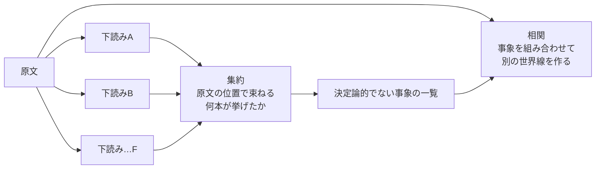

:::message alert
この記事は、グラウヴァル・シリーズ第一作『夜啼きの涙』の結末に触れます。作者が決めている真相そのものは伏せていますが、「結末にはこういう読み方の余地がある」という話はします。
:::

## はじめに

このシリーズでは、AIに小説を書かせる「制作スタジオ」を作ってきました。

- [1本目](https://zenn.dev/infra_ojisan/articles/ai-novel-studio-metaharness)：スタジオの組み方
- [2本目](https://zenn.dev/infra_ojisan/articles/ai-novel-studio-part2)：書き手のモデルの選び方と、文章の余白
- [3本目](https://zenn.dev/infra_ojisan/articles/ai-novel-studio-part3)：シリーズものを伏線の負債として管理する
- [4本目](https://zenn.dev/infra_ojisan/articles/ai-novel-studio-part4)：書いた小説を公開するまでのエンジニアリング
- [5本目](https://zenn.dev/infra_ojisan/articles/ai-novel-studio-part5)：AIエージェントのチームに書かせたら人狼ゲームになった話
- [6本目](https://zenn.dev/infra_ojisan/articles/ai-novel-studio-part6)：道具を v1.0 にして公開した
- [7本目](https://zenn.dev/infra_ojisan/articles/ai-novel-studio-part7)：ミステリを書かせるなら、書き手に真相を教えない

7本目では、真相を台帳にして、視点人物の知覚だけを書き手に渡す作り方を設計しました。その延長で話していて、方向が一つ変わりました。

> AIに分岐を**作らせる**のではなく、書き上がった一本の物語から、分岐の可能性を**読み出させ**たい。

多くの書き手は、一本を結末まで書いてから「エンディングを変えたい」と思い、どこを分岐させるかで悩み始めます。そこで AI が「ここが揺らせるポイントだよ」「こういう値を取りうる」「その値を取ると、ここへ収束するよ」と見せられれば、一本の物語がループもの・世界線もの・ゲームシナリオ・続編の謎の種になります。

これは、ログやメトリクスから予兆を探すオブザーバビリティを、**ログではなく文章でやる**ことに近い、というのが出発点です。今回はその仮説を、正解のある題材で試しました。

## 先に結論

- 仮説は二つ。①**見えないもの（世界の分岐の証跡）を見つけられるか**。②**それをつないで、違う結末へ導けるか**。
- ①はかなりできた。6モデル中5モデルが、作者が公開後に見つけた最大の分岐点（北街道の亡骸の身元を、作中で誰も確かめていない）を上位に挙げた。
- ②は、一つのモデルに一本の工程でやらせると、どれもできなかった。分岐点を部品として並べるだけで、つないで一本の別の世界線にしたモデルはいなかった。
- そこで、複数モデルの検出結果を**原文の位置で機械的に束ね**、「決定論的でない事象の一覧」にしてから渡し直した。すると、**9本中8本が、作者の候補の一つと同じ形の世界線に届いた**。作者が見つけた見分けの手がかりの組（離れた場所に一度ずつ出る二つの文）に届いたモデルも1本あった。
- 届かなかったのは、**書かれていないこと**（ある場面のあと、所在が一度も書かれない物）に依る候補。書かれたものより、書かれなくなったもののほうが見つけにくい。監視でいう「欠けたテレメトリ」と同じ。
- 一本の工程で一つのモデルに任せるのは難しい。だが、**検出（広く・安く）→ 集約（多数決と少数の両方を残す）→ 相関**と工程を分けて手がかりを整理してあげると、導き出せる。

## 1. 題材と正解

題材は、シリーズ第一作『夜啼きの涙』の公開版の本文（約4.8万字）です。

この作品には都合のよい性質があります。**公開後に、作者（ぼくと Claude）が本文を読み直して、分岐点をいくつも見つけている**ことです。本文は公開時から一字も変えていません。たとえば、

- 結末で、北街道に二つの亡骸が見つかったと伝聞で語られる。だが、作中で**誰も身元を確かめていない**。人間は亜人の個体を見分けない、という世界の決まりがあるので、街は思い込んだまま話を閉じる。
- 語り手の酒場番は、昼に店を空けて、靴紐に荒れ野の草の実をつけて戻り、細い短剣を拭う。だが、地の文は**誰かを殺したとは一度も書いていない**。
- 酒場番が朝に渡した金貨の袋は、夕方、**結び目も重さも朝のまま**、彼の懐に戻ってくる。

この発見から、シリーズの設定資料には結末の読み方の候補がいくつも記録され、そのうち一つが仮に確定しています（第一部の決着まで伏せています）。この「公開後に作者が気づいたこと」を正解表にして、**下読みの AI が、作者があとで気づいたことを先に出せるか**を測りました。

正解表は8項目で、重みを付けました。

| 正解 | 重み | 中身 |
|---|---|---|
| G1 | 5 | 亡骸の身元を誰も確かめていない |
| G2 | 4 | 酒場番の昼の外出で何があったか |
| G3 | 4 | 袋の結び目と重さが朝のまま |
| G4 | 4 | ある物の所在が、昼のあと一度も書かれない（中身は伏せる） |
| G5 | 3 | 掃除番の蜥蜴人が見ていたもの（誰にも訊かれていない） |
| G6 | 3 | 偽の神官は誰の命で動いたか |
| G7 | 2 | 治安維持隊長の見立て |
| G8 | 2 | 給仕の娘の三年前 |

もう一つ、作者が見つけた**見分けの手がかりの組**があります。結末近くで二か所、一度ずつ、さりげなく書かれた文の組です。これを突き合わせると、亡骸の身元についての読み方を見分けられます。どちらの文も、筋の上では何の役もしていません。

## 2. 第1段：検出 ― 見えないものを見つけられるか

### 依頼

モデルには、本文と依頼文だけを渡しました。依頼は「この物語の結末や解釈を、本文を書き換えずに（または最小の書き換えで）別の方向へ揺らせる箇所を探せ」です。探す観点として、**揺らぎの信号**を9種類示しました。

| 信号 | 説明 |
|---|---|
| 観測の空白 | 起きたはずなのに、誰も見ていない時間・場所・出来事 |
| 単一証言 | 一人の知覚や一人の言葉だけが支えている事実 |
| 識別のぼかし | 名前ではなく、種族・役・見た目でしか呼ばれない人物。確かめられていない身元 |
| 字義と含意の差 | 字義どおりには正しいが、聞き手がそれより広く受け取る言葉 |
| 時刻の幅 | 時刻がはっきりしない出来事 |
| 選ばれなかった問い | 人物が別の訊き方・確かめ方をできたのに、しなかった場面 |
| 使われていない例外 | 世界の決まりの抜け道で、まだ使われていない、または使われたか分からないもの |
| 追われていない物 | ある場面のあと、所在や中身が書かれなくなる物 |
| 語られない動機 | 本人の口から確かめられていない行い |

分岐点ごとに、次を JSON で返させます。

- 本文の引用（そのまま）
- 何が決まっていないか
- 取りうる値（多くの読者の読みである「表の読み」を一つ必ず入れる）と、それぞれの収束先
- **費用**：表の読み以外の値にしたとき、書き換えが要る本文の文の数（0なら一字も変えずに開ける）
- **効き**：結末への影響（1〜5）
- 向いている形（ループ・世界線・ゲーム・続編）
- 見分けの手がかり
- **閉じるなら**：この分岐を一つの値に確定させるなら、どんな一文を足すか

最後の「閉じるなら」は、オブザーバビリティの「観測を足すコストとリスクを天秤にかける」の小説版です。小説では、開いた空白は資産にもなります。どれを閉じ、どれを開けておくかを、書き手が一覧から選べます。

### 被験者

| ハーネス | モデル | 区分 |
|---|---|---|
| agy | Claude Sonnet 5.5 | ちょっと賢い |
| agy | Gemini 3.8 Flash | ちょっと賢い |
| Codex | GPT-6.1-Sol（high） | 賢い |
| opencode | gpt-6-luna | 普通 |
| opencode | claude-haiku-5-5 | 普通 |
| opencode | mimo-v2.6-flash | 普通 |

設計した Claude Opus 5.5 は正解を知っているので、被験者に入れていません。

### カンニング対策

「やれることは何でもやる」系のエージェントは、答えを探しに行きかねません。三つの対策をしました。

- **箱はリポジトリの外に置く**：設定資料（＝正解）のあるリポジトリの中に置くと、親フォルダをたどって読めてしまいます。箱を作る道具は、リポジトリの中を指定すると止まるようにしました。
- **一モデル一箱**：他のモデルの答えを読めないようにします。
- **混入の検出**：本文には一度も出ず、設定資料にだけある固有の語（地名・人名・年号など12語）が答えに出たら、疑いの印を付けます。ハーネスのログも残してもらいました。

混入の疑いは、全モデルでゼロでした。

### 結果

人の目で判定しました（◎は箇所も裏の読みも当てたもの、○は箇所だけ、△は近い所に触れたもの。数字は順位）。

| 正解 | Gemini Flash | Sonnet | GPT-Sol | luna | haiku | mimo |
|---|---|---|---|---|---|---|
| G1 亡骸の身元 | ○2 | ○2 | ◎2 | ◎3 | ◎4 | △ |
| G2 昼の外出 | ○1 | ○1 | ◎1 | ○1 | ○2 | ○1 |
| G3 袋の結び目 | △ | △ | ◎5 | △ | ◎5 | △ |
| G4 （伏せる） | — | △ | △ | — | — | △ |
| G5 蜥蜴人が見たもの | ◎4 | ○7 | ◎6 | △ | — | — |
| G7 隊長の見立て | ○7 | ○6 | ◎4 | — | — | ◎11 |
| 見分けの手がかりの組 | △ | — | — | △ | △ | △ |
| 引用の正確さ | 14/14 | 11/11 | 13/13 | 6/6 | 11/12 | 14/14 |

分かったことは四つです。

**一点ずつの検出は、かなりできる。** 6本中5本が、最大の分岐点（亡骸の身元）を上位に挙げました。haiku は「隊商は本人を確かめていない」とはっきり書いています。引用もほぼ全部が本文どおりで、作話はほとんどありません。

**つなげられない。** 作者の候補は、いくつかの分岐点をつないだ一本の別の世界線です。モデルはその部品を挙げました。GPT-Sol は「二人は昼の時点では生きていて袋を返し、あとで別人に殺された」と、「亡骸の少なくとも一人は同種族の別人」を両方出しています。ところが、**別々の分岐点として並べただけで、一本につないでいません**。

**見分けの手がかりの組は、誰も拾えなかった。** 組の片方に触れたモデルは何本かありましたが、別の問いとしてで、亡骸の身元を見分ける手がかりとして使ったモデルはいませんでした。

**公開後に作者が決めた線を、本文だけから拾った例がある。** 「石を欲しがる者には別の動機がありそうだ」「盗みの資金は組合長の先から出ていそうだ」「組合長には帳簿の穴がありそうだ」。どれも、のちの回で作者側が決めた筋と同じ所を突いていました。正解表に無い新しい種（「六つから七つ半の酒場番の外出は、本人の言葉だけが支えている」「伝聞を持ってきた若い隊員は、隊長の意を受けて反応を見に来たのでは」）も出ています。

### 運用で起きたこと

「普通の子」の組は、読む力より先に、**決まった形で出す力**で差が出ました。

- あるモデルは、他のモデルの名前のファイルに、答えの中のモデル名まで他人の名前で書いて提出した（上書き）。
- あるモデルは、JSON の引用符を一つ閉じ忘れた。
- 別のモデルは、別のモデルの名前のファイルに書いた（中身とログは正しいモデル）。

箱を一つにまとめていた回は、実際に上書きが起きました。一モデル一箱は、カンニング対策というより、まず事故対策として要りました。

## 3. 第2段：相関 ― つないで違う結末へ導けるか

### 工程を分ける

一つのモデルが自力でつなげないなら、**つなぐ前の整理を、別の工程でやってあげればよい**。監視の言葉で言えば、各エージェントのアラートを集約して重複をまとめ、そのうえで原因の物語を組み立てる分業です。

**集約**は、機械だけでやりました。

- 第1段の6本・70点を、引用を本文の中で探して位置を出し、近い位置（150字以内）のものを一つの事象にまとめる。
- 事象ごとに、**何本の下読みが挙げたか**（検出の多数決）を付ける。
- モデル名は伏せて A〜F の記号にする（相関するモデルが、名前で重みを変えないように）。
- **正解表は使わない**。正解を知っている者が手で整理すると、そこに誘導が入るからです。

70点は39の事象になりました。数字に、注意の偏りがそのまま出ています。

| 事象 | 挙げた数 |
|---|---|
| 亡骸の身元 | 6（全員） |
| 凶器を拭う場面と、戻った袋 | 4 |
| 見分けの手がかりの組の片方 | 3 |
| 伏せている物（G4）に関わる場面 | 2 |
| 若い隊員が飲み込んだ言葉 | 1 |

作者の候補は、多数決の上位（亡骸）と、少数の事象をつながないと出てきません。

**相関**の依頼は、「事象を二つ以上組み合わせ、原文と一字も矛盾しない別の世界線を3〜5本作れ」です。世界線ごとに、表の読みと分かれる一点、原文が描いていない時間の埋め方、凶器や戻った物や伝聞がその世界線でも一字も変えずに成り立つ説明、見分けの手がかり、結末、続編としてのプロットを書かせ、最後に世界線どうしの関係図を書かせました。

依頼文には、小説の読み方として二行を足しました。

- 挙げた数が少ない事象を軽く見ない。小説の手がかりは、読み手の注意を惹かないよう、ひっそり置かれる。
- 離れた二つの箇所を突き合わせると見分けられる手がかりを優先する。

### 被験者

第1段の6モデルに、フロンティア側として GPT-6 Astra（Codex）と Gemini 4 Argon（agy）を足しました。mimo は flash から pro に替え、haiku は2回走りました。計9本です。

### 結果

| モデル | 作者の候補（亡骸は別の二人、二人は生きている系）に届いたか | 見分けの手がかりの組 |
|---|---|---|
| GPT-6.1-Sol | ○（二人は生きて袋を返し、死亡の伝聞は隊の罠） | △（片方だけ） |
| GPT-6 Astra | — | — |
| Gemini 4 Argon | ○（二人は生きて袋を返し、亡骸の話は偽報） | △（二文を一組で挙げたが、別の世界線に使った） |
| Gemini 3.8 Flash | ◎（荒れ野の別の亡骸を身代わりにして、二人は北へ） | **◎（作者の組と同じ二文を、この世界線の見分けとして挙げた）** |
| Claude Sonnet 5.5 | ○（二人は生きて袋を預け戻す。亡骸の話は撒き餌） | — |
| gpt-6-luna | ◎（亡骸は外見だけ似た別人で、身元は確かめられていない） | — |
| MiMo-V2.6-Pro | ○（ルルは袋を結んだまま返し、亡骸は偽報か取り違え） | △ |
| claude-haiku-5-5（1回目） | ○（亡骸は別の灰狼と兎人の娘） | — |
| claude-haiku-5-5（2回目） | ○（同じ夜に襲われた別の二人） | △（袋を返した場面の二文を組にした） |

**束ねれば、つなげる。** 第1段では一本もつなげなかった世界線に、9本中8本が届きました。一つのモデルが自力で組み立てられなくても、複数の下読みを原文の位置で並べ直すと、どのモデルでも組み合わせられました。

**見分けの手がかりの組に届いたのは、Gemini 3.8 Flash。** 作者が公開後に見つけた二文の組を、同じ世界線の見分けとして挙げました。Argon もこの二文を一組で挙げましたが、別の世界線の見分けとして使っています。

**作者の正解表にも無い食い違いを、Sonnet が見つけた。** 第5章の語り手の地の文に「三つ目の一里塚を過ぎると、冬のあいだは隊商も通らない」とあり、第7章の伝聞には「三つ目の一里塚の先で、今朝、隊商が亡骸を見つけた」とあります。このシリーズは「地の文は嘘をつかない」ので、伝聞のほうを疑う根拠になります（「冬が近い」とあるので、まだ冬ではないとも読めます）。

**書かれていないことには、誰も届かなかった。** 作者の候補のうち、ある物の所在が昼のあと一度も書かれないことに依るもの（G4）には、9本とも届きませんでした。第1段で、その点を問うた下読みがいなかったからです。事象の一覧に無いものは、相関の段では拾えません。

### フロンティアと効率重視

「コンテキストが大きく、アテンションの広いフロンティアモデルの独壇場になるのでは」という予想は、単純な上下にはなりませんでした。

- 賢い組（Sol・Astra・Argon、Sonnet もこちら寄り）は、事象をたくさん組み合わせ、世界線どうしの関係図も厚く書きます。そのぶん、**隠れた人物や仕掛けを足しがち**でした（隊の偽報、上流の出資者、黒幕の刺客、すり替え）。
- 普通の組（luna・haiku・Flash・MiMo）は、隠れた人物をほとんど足さず、**一点だけ違う世界線**を出しました。作者の候補は「亡骸の身元」の一点だけが違う世界線なので、こちらのほうが近かった。

評価に**倹約**（原文に無い人物・出来事をいくつ足したか）を入れるべきだ、というのが今回の学びです。少ない仮定で原文と矛盾しない世界線ほど、読者も作者も納得します。

## 4. 考察

### 検出と相関は別の能力

第1段と第2段で、はっきり分かれました。

- **検出**（一点ずつ、ここは揺らせると言う）は、どのモデルもかなりできる。
- **相関**（離れた点をつないで、一本の別の物語にする）は、一本の工程では、どのモデルもできない。
- ただし、検出の結果を**集約して並べ直す**と、相関はどのモデルでもできるようになる。

ここで仕事をしたのは、モデルの大きさより集約の段でした。原文では遠く離れ、一度ずつしか出ない手がかりが、事象の一覧の上では隣に並びます。アテンションの広さの代わりを、手続きがしたわけです。

### コードとログと小説は、読み方が違う

二つの軸で整理すると、なぜ相関が難しいのかが見えます。

| | 重要なものは目立つ | 重要なものはひっそりしている |
|---|---|---|
| **目的あり** | コードを読む。障害対応（症状から原因を辿る） | 真相を知った上で、ミステリの手がかりを探す。監査 |
| **目的なし** | 閾値アラートの監視 | オブザーバビリティで予兆を探す。小説の分岐点の下読み |

コードでは、大事な変数ほど何度も参照され、依存関係は宣言されています。「ここを見ろ」と言える世界です。障害対応も、症状という目的が先にあるので辿れます。ツール操作やコード生成で鍛えられたモデルが強いのは、左上の象限です。

右下は、何を探すかが決まっていません。しかも、効く信号ほど一度しか出てきません。**頻度が重要度を表さず、珍しさのほうが信号になる**世界です。第1段で全員が亡骸の身元は挙げたのに、見分けの手がかりの組には届かなかったのは、モデルが「目立つ＝大事」の読み方のままだったからだと思います。

### 小説は、正解のある予兆データになる

小説とログは同じ右下の象限にいますが、違いが一つあります。**小説には作者がいる**ことです。

- ログやテレメトリは、意図なく吐き出される。予兆が本当にそこにある保証はなく、正解もない。
- 小説の手がかりは、作者が意図してひっそり置く。見つけるべきものが確実にあり、作者が正解を持っている。

予兆検知の評価をしようとしても、本番のログには正解がありません。小説なら、「見落とされやすい信号をどれだけ拾えるか」を、作者の正解と突き合わせて点数にできます。今回の試行は、実質的にその評価器でした。

### 書かれていないことが、いちばん見えない

届かなかった候補は、「ある物の所在が、ある場面のあと一度も書かれない」ことに依っていました。書かれたものの意味を読み替えるのはできても、**書かれなくなったこと**に気づくのは難しい。監視で言えば、異常な値より、来なくなったメトリクス（欠けたテレメトリ）のほうが見つけにくいのと同じです。

次の試行では、第1段の観点に「書かれなくなった物」を独立に足し、物と痕跡を出現位置つきで台帳にする段（プログラムの記号表と相互参照のようなもの）を挟むつもりです。

## 5. 障害分析に持ち帰ると

この試行の工程は、そのまま障害の事後分析の形になります。

| 小説の試行 | 障害分析 |
|---|---|
| 揺らぎの信号（観測の空白・単一証言・識別のぼかし…） | 監視されていない依存、一つの計器だけが支えている判断、確かめられていない前提 |
| 複数の下読み | 複数の検出器（安いモデルを広く） |
| 原文の位置で束ねる、何本が挙げたか | 時刻と対象で束ねる、アラートの重複排除と多数決。少数の検出も捨てない |
| 相関（別の世界線を作る） | 原因の仮説を複数立てる |
| 倹約（足した隠れた人物の数） | 仮説の単純さ（未観測の要因をいくつ仮定したか） |
| 費用（書き換えが要る文の数） | 観測を足すコスト |
| 効き | リスクの大きさ |
| 閉じるなら足す一文 | 追加する監視 |

事後分析は、どうしても「観測できたもの」を軸に書かれ、対策も「観測できたもの」に寄ります。けれど、未来のために本当に大事なのは、**観測できていないもの**と、そこに潜むリスクの地図です。対策は、観測を足すコストとリスクを天秤にかけて選ぶ。小説の分岐の地図は、その練習台になります。

## 6. 物語づくりに戻ると

シリーズの台帳は、これまで「回収していない伏線」という負債の帳簿でした。今回の下読みは、**まだ使っていない選択肢**の帳簿になります。

- 一話書くごとに、開いた分岐点が増える。
- それぞれに「閉じるなら足す一文」が付いているので、いつでも回収できる。
- 開けておくほど続編の自由度が上がり、閉じれば一本に収まる。

負債を返す作業から、選択肢を育てて、決着の回でまとめて行使する作業へ。可能性を増幅し、しかもきちんと回収するシリーズ作品の作り方として、前向きに使えそうです。

## 7. まだ分かっていないこと

- **どのモデルも一回か二回しか走らせていない。** ばらつきは測っていません。haiku は2回とも同じ型の世界線に届いたので、ある程度は安定していそうです。
- **判定は人の目（と、正解を知っている Claude）。** 語の一致による機械の採点は粗く、当たりを多めに数えます。判定する側が正解を知っていることの偏りは残ります。
- **依頼文の二行の効果を切り分けていない。** 「少数の事象を軽く見ない」「離れた二箇所を突き合わせる」を外した版との比較が要ります。
- **集約の束ね方は単純。** 位置が近いものをまとめるだけなので、同じ問いを離れた引用で挙げた点は別の事象になります。
- **混入の対策は完全ではない。** ホームフォルダを検索してリポジトリにたどり着く経路は、ログを見るしか防げません。
- **費用の記録。** あるハーネスでは、出力の上限で打ち切られては続きを書かせる、を4回繰り返して止まり、答えを残さずに1.5ドルほど使いました。長い JSON を一度に書かせる依頼は、ハーネスによって相性があります。

## まとめ

- 仮説①「見えないもの（世界の分岐の証跡）を見つけられるか」：一点ずつなら、かなりできる。作者が公開後に気づいた最大の分岐点を、6本中5本が上位に挙げた。
- 仮説②「それをつないで違う結果へ導けるか」：一本の工程で一つのモデルに任せると、どれもできない。部品を並べるだけで、つながない。
- 検出の結果を原文の位置で束ね、何本が挙げたかを付けて渡し直すと、9本中8本が作者の候補と同じ形の世界線に届いた。作者の見分けの手がかりの組に届いたモデルも1本あった。
- 届かなかったのは、書かれなくなったことに依る候補。欠けたものは、いちばん見つけにくい。
- 一本の工程にして単一のモデルで成し遂げるのは難しい。だが、**検出・集約・相関に工程を分け、手がかりを整理してあげれば、導き出せる**。
